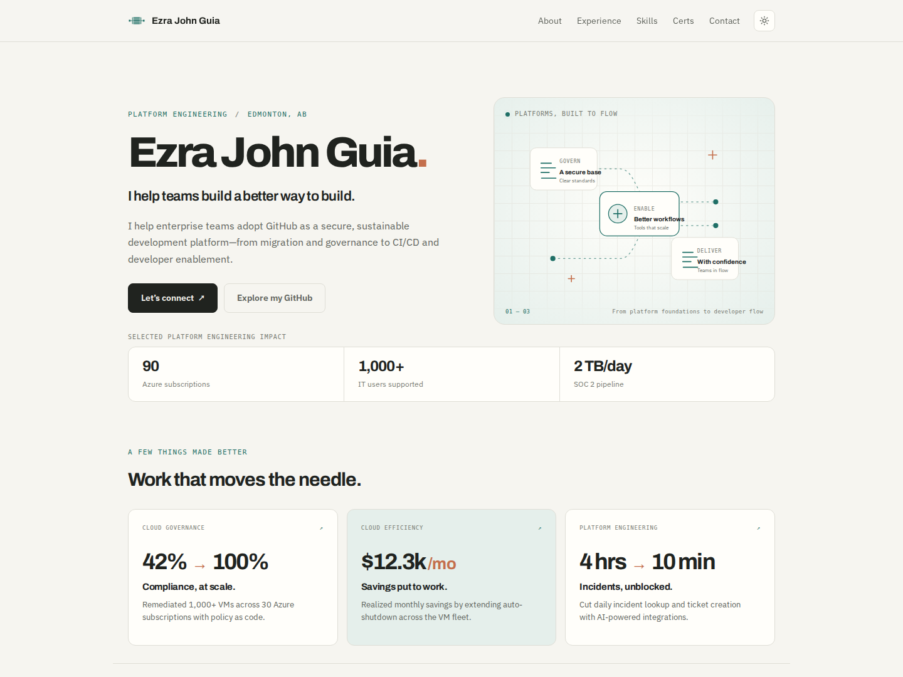

# Ezra John Guia — GitHub Platform Consultant

Personal portfolio/resume site deployed to GitHub Pages.

## Live Site

[https://ejohnguia.github.io](https://ejohnguia.github.io)



## Stack

- **HTML/CSS** — Vanilla, no build step
- **Fonts** — Archivo and IBM Plex Sans (Google Fonts), system monospace
- **Deployment** — GitHub Pages from the `main` branch
- **Validation** — HTML Validate and Playwright (development only)

## Local Development

```bash
# Serve locally
python3 -m http.server 8000
# or
npx serve .
```

Open `http://localhost:8000`

## Checks

The site needs no Node.js tooling to serve or deploy. For development checks,
use Node.js 22 and Python 3:

```bash
npm ci
npx playwright install chromium
npm test
```

On Linux, Playwright may also require system libraries; use
`npx playwright install --with-deps chromium` when needed.

Checks cover HTML, local assets and fragment links, responsive layouts from
320px to 1440px, section/caption spacing, theme persistence, mobile navigation,
and print styles. GitHub Actions runs these checks on pushes to `main` and pull
requests; this validation workflow does not deploy the site.

To refresh the README screenshot, start the local server on port 8000 and run:

```bash
npm run preview:screenshot
```

## Deploy to GitHub Pages

Push to `main` to trigger the GitHub Pages branch deployment. There is no
separate repository deployment workflow.

Configure Settings → Pages → Build and deployment to use **Deploy from a branch**,
with `main` and `/ (root)`.

### Custom domain (optional)

Set the domain in the repository's **Settings → Pages** and include a valid `CNAME` file in the site root before deploying. No Actions secret is required.

## Project Structure

```
├── index.html      # Main page (semantic HTML, JSON-LD schema)
├── style.css       # Editorial light/dark theme, responsive grid, design tokens
├── assets/         # Icons, original artwork, and social/README previews
├── tests/          # Playwright browser checks
├── playwright.config.js
├── .github/workflows/validate.yml  # Validation only
├── LICENSE         # MIT
└── README.md
```

## Features

- Responsive light/dark editorial theme with CSS Grid/Flexbox
- Mobile hamburger navigation (accessible, keyboard support)
- Illustrated platform-engineering hero, selected impact cards, and a responsive experience timeline
- Skills grouped by GitHub/CI/CD, cloud, infrastructure, platform tooling, and languages
- Certifications with verified Credly/Microsoft links
- JSON-LD Person schema for SEO
- `prefers-reduced-motion` support
- Print-friendly résumé layout
- All external links: `rel="noopener noreferrer"`

## Customization

Edit `index.html` for content, `style.css` for design tokens (colors in `:root`).

### Brand assets

- `assets/icons/workflow-master.png` and `assets/images/og-background.png` are the original supplied artwork; keep them unchanged.
- `assets/icons/workflow-mark.svg` is the clean, transparent vector version of the full pipeline mark. The master PNG has a baked-in checkerboard, not an alpha channel.
- `assets/icons/favicon.svg`, its 16/32px PNG fallbacks, and the monochrome Safari pinned-tab SVG use the same six-lane geometry as `workflow-mark.svg`. The SVG favicon changes teal with the browser's color scheme.
- The header uses `workflow-mark.svg` as a silhouette with the site's selected theme color. Touch and manifest icons use the same full mark on cream.
- Favicon, touch-icon, manifest, social-image, and stylesheet URLs use a `v` query parameter to refresh cached assets when the branding changes. Update manifest icon URLs along with the manifest link when replacing those icons.
- `assets/images/og-image.png` is the 1200×630 social preview, composed from the supplied background, clean mark, and typeset name and title.

## License

MIT — feel free to fork and adapt.